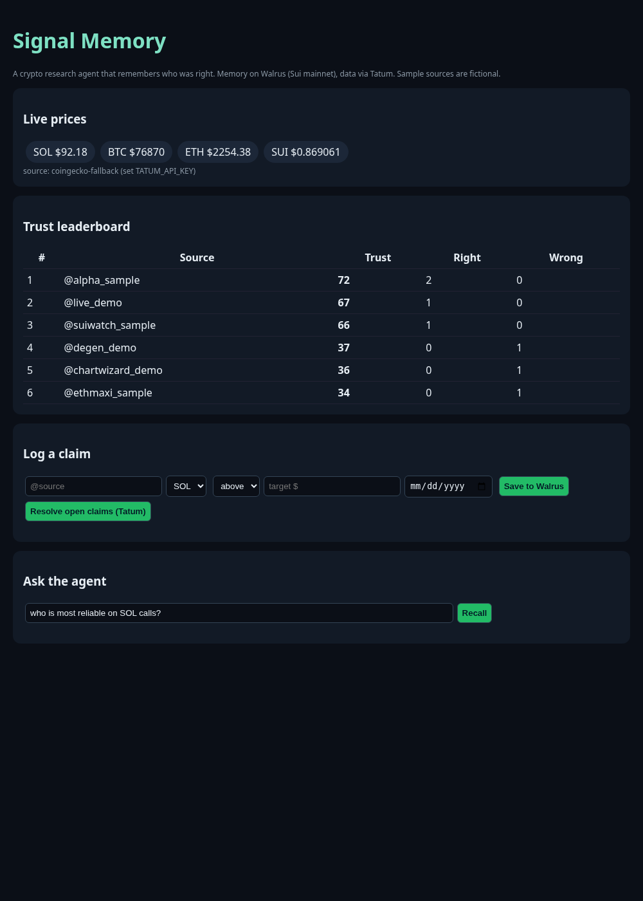

# Signal Memory

**A crypto research agent that remembers who was right.** Built for the Walrus x Tatum "Total Recall" hackathon, *Smart Agents for Real Life* track.

Every time a source (a KOL, a newsletter, an analyst) makes a call, Signal Memory saves it to **Walrus Memory on Sui mainnet**. When the deadline passes, it checks the live price through **Tatum**, marks the call RIGHT or WRONG, recalculates that source's trust score, and saves the outcome back to Walrus. Ask it "who is most reliable on SOL calls?" and it answers from its own long term memory.

> All sources in the demo are fictional sample handles (`@alpha_sample`, `@degen_demo`, ...). No real people are scored.



## Architecture

```
 browser (public/index.html)
        │  fetch
        ▼
 server.mjs (Node, no framework)
   ├── tatum.mjs   → Tatum Data API (live SOL/BTC/ETH/SUI prices)
   │                 Tatum Sui RPC gateway (onchain reads)
   ├── trust.mjs   → trust score math (recency weighted)
   ├── resolve.mjs → resolve due claims, write outcome + new score
   └── client.mjs  → Walrus Memory SDK (@mysten-incubation/memwal), namespace `trust-scores`
                      relayer: https://relayer.memory.walrus.xyz  (Sui mainnet)
```

## Setup

Node 20+.

```bash
npm install
export MEMWAL_PRIVATE_KEY=...   # Walrus Memory delegate key (never commit)
export TATUM_API_KEY=...        # free key from https://dashboard.tatum.io
node server.mjs                 # http://localhost:3000
```

Without `TATUM_API_KEY` the price feed falls back to CoinGecko and every result is labeled `coingecko-fallback`, so you can always tell which source was used.

Scripts:
- `node validate.mjs` health check and authenticated recall
- `node seed.mjs` stores the 12 demo memories and logs receipts
- `node recall.mjs "query"` semantic recall
- `node resolve.mjs --force` resolve open price claims now

## Trust score

Each resolved call counts +1 (right) or −1 (wrong), weighted by recency with a 30 day half life:

```
w     = 0.5 ^ (ageDays / 30)
score = 50 + 50 * Σ(w·outcome) / (Σw + 2)
```

The `+2` prior keeps a brand new source near 50 until it builds a track record.

## Proof: memories on Walrus mainnet

Account `0x34460a5e49be15c45a947d770ce887f958a9453028d51fa41b56662e6c5cb6ca`, namespace `trust-scores`. Full log with job ids and timestamps in [`memories-log.json`](memories-log.json).

| # | blob_id | memory |
|---|---|---|
| 1 | `IKUzgsA-64LyHLzIAxFMCSynV-Q7EaN37yx-ANHEDC4` | [DEMO] Claim logged 2026-10-01: @alpha_sample (fictional sample source) predicted SOL would reclaim $200 within 14 days. Asset: SOL. Status: pending. |
| 2 | `2_bFmql_MpaiPkFrF-EN55cioLnRjmV40sUUrOXe8iw` | [DEMO] Outcome 2026-10-15: @alpha_sample SOL $200 call was RIGHT (SOL closed at $204). Trust score for @alpha_sample raised 62 -> 70 on SOL calls. |
| 3 | `--fB_QB8LZ4EIPySFFicV4RT5bk99o0sj6vWW81lJ_g` | [DEMO] Claim logged 2026-10-02: @degen_demo (fictional sample source) predicted BTC would drop below $90k by Oct 20. Asset: BTC. Status: pending. |
| 4 | `EuVKX3J4hjs9XZ6Ok6_V8wpgReh43TvU_z_Af90cBYE` | [DEMO] Outcome 2026-10-20: @degen_demo BTC sub-$90k call was WRONG (BTC held above $105k). Trust score for @degen_demo lowered 55 -> 44. |
| 5 | `wdcBPnKZhR3SQS29i2yBeUtrg9LU7T6zXDfOXEEh150` | [DEMO] Claim logged 2026-10-03: @suiwatch_sample (fictional sample source) said SUI DEX volume would beat its monthly high in October. Asset: SUI. Status: pending. |
| 6 | `0FCR07G1vk6vWdRH_cVfvdBvBm8TWVd2JPNhXNz25y0` | [DEMO] Outcome 2026-10-31: @suiwatch_sample SUI DEX volume call was RIGHT. Trust score for @suiwatch_sample raised 58 -> 67 on SUI ecosystem data. |
| 7 | `_amUDNhgoQHCiQHXwIqZQZdny6ewgWyY9sxPjk_h-8U` | [DEMO] Claim logged 2026-10-05: @chartwizard_demo (fictional sample source) predicted SOL would fall to $150 by Oct 25. Asset: SOL. Status: pending. |
| 8 | `7D377wfXzbZ5BgmJlHKr6aMIvslPlPqUdD5clrwaqDs` | [DEMO] Outcome 2026-10-25: @chartwizard_demo SOL $150 call was WRONG (SOL stayed above $190). Trust score for @chartwizard_demo on SOL lowered 50 -> 38. |
| 9 | `3tnRq0DSxRmb-H5cblK086DII4W1NiLoF2f6JBrJDBA` | [DEMO] Claim logged 2026-10-08: @alpha_sample predicted a major Solana memecoin launchpad would cut fees before November. Asset: SOL ecosystem. Status: pending. |
| 10 | `fOfSjx-l8GEcE3NNScji6uMpleIDUm_9e7nLd-gJFW8` | [DEMO] Outcome 2026-10-29: @alpha_sample launchpad fee-cut call was RIGHT. @alpha_sample now 2/2 on SOL calls; trust score raised 70 -> 78. Most reliable SOL source so far. |
| 11 | `nNAXnp8KUEZSd5YwnND712Y813ecUAEemo8jY3E9Kqg` | [DEMO] Claim logged 2026-10-10: @ethmaxi_sample (fictional sample source) predicted ETH/BTC ratio would rise above 0.04 by end of October. Asset: ETH. Outcome 2026-10-31: WRONG. Trust score lowered 60 -> 51. |
| 12 | `LpIubEcSFWxPFsnySLZsbG8-hMo0P5JYVM0es0wUqKU` | [DEMO] Trust leaderboard snapshot 2026-11-01 (sample data): @alpha_sample 78 (SOL specialist, 2/2), @suiwatch_sample 67 (SUI, 1/1), @ethmaxi_sample 51, @degen_demo 44, @chartwizard_demo 38 (0/1 on SOL). |
| 13 | `M--ofVG_vKzL8JUi4cweZxwtPoF7Sw8pubujCwf3H78` | Claim logged 2026-11-03: @live_demo predicted SOL above $90 by 2026-11-10. Status: pending. |
| 14 | `e2DngSNelwjWDCp0jqeRV2zrY4OGv6-88HER9TCQ68s` | Outcome 2026-11-03: @live_demo SOL above $90 call was RIGHT (SOL at $92.18 via coingecko-fallback (set TATUM_API_KEY)). Trust score for @live_demo 50 -> 67. |

## Repository

https://github.com/ajahelube/signal-memory
